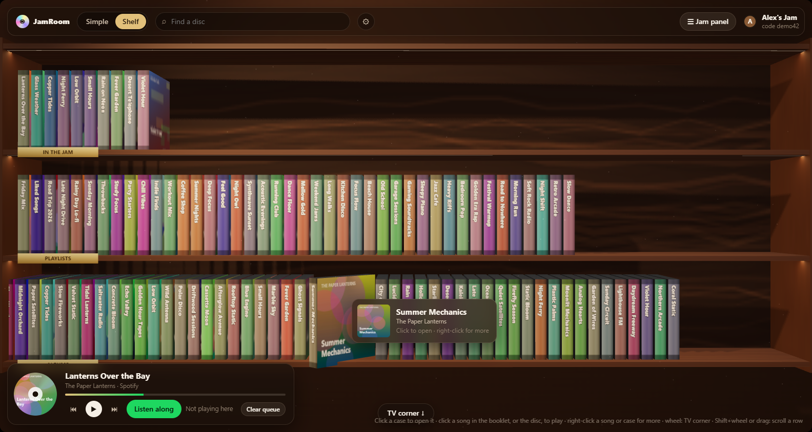
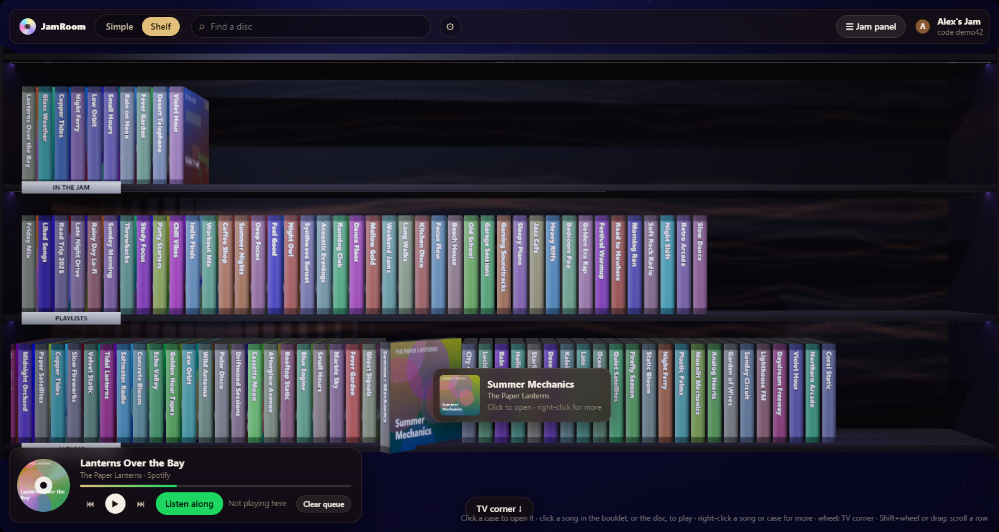

# JamRoom

**Listen together inside Spotify, with songs from anywhere.** JamRoom is a
[Spicetify](https://spicetify.app) extension that works like Spotify Jam, except the queue can mix
Spotify songs with YouTube, SoundCloud, audio links and your own files. Friends' Spotify apps
connect to each other directly, so there is no server to run.



## Install

**From the Spicetify Marketplace:** open Marketplace in Spotify, search for **JamRoom** and click
Install.

**With the installer (Windows):** download `JamRoom-for-Spotify.zip` from the
[latest release](https://github.com/okabeeer/JamRoom/releases/latest), unzip it and double-click
**Install JamRoom.cmd**. It installs Spicetify if needed, adds JamRoom, checks that it worked and
can turn on the Discord status. If something goes wrong it writes `JamRoom report.txt` on your
Desktop.

**By hand:**

```powershell
iwr -useb https://raw.githubusercontent.com/spicetify/cli/main/install.ps1 | iex   # Spicetify, once
New-Item -ItemType Directory -Force "$env:APPDATA\spicetify\Extensions" | Out-Null
Copy-Item .\spicetify\jamroom.js "$env:APPDATA\spicetify\Extensions\"
spicetify config extensions jamroom.js
spicetify apply
```

To remove it: `spicetify config extensions jamroom.js-` then `spicetify apply` (or uninstall it
in Marketplace).

Then click the **headset** button in Spotify's top bar (or next to the volume, or press
**Ctrl+Alt+J**), enter your name and **Start a Jam**. Send friends the 6-character code; they
type it under "or join a friend". Everyone needs Spotify desktop with JamRoom.

## What it does

- **One queue from anywhere:** Spotify songs, albums and playlists (right-click → **Add to Jam
  queue** / **Add to Jam library**), YouTube, SoundCloud, direct audio links, and your own files.
- **Everyone hears the same moment.** Each person clicks **Listen along**; "In sync · 30 ms" shows
  how close that device is.
- **Your files stay on your computer** and go straight to friends when their turn comes (up to
  60 MB each).
- **Playlists:** build Jam playlists together, and keep any of them in **Your playlists** to play
  again in a later Jam.
- **Host controls** like Spotify Jam: let others change what's playing or only add to the queue,
  remove people, end the Jam. The host's Jams survive a Spotify restart.
- **Your Spotify profile picture and name** in the Jam.
- **Two views:**
  - *Simple*: a panel with now playing, queue, library and playlists.
  - *Shelf*: a 3D room where the Jam, your playlists and your albums are glass CD cases on a lit
    shelf. Hover a case to pull it out, click to open it, and the booklet lists the songs (click
    one to play from there). Right-click a song or case for more. Scroll down to a TV corner where
    an old CRT plays the song's Spotify Canvas and a whiteboard writes the lyrics in time with the
    song. Three looks (Walnut, Birch, Ebony neon) and quality settings for slower PCs.
- **Lyrics for every source:** Spotify's own lyrics for Spotify songs, and
  [LRCLIB](https://lrclib.net) for YouTube, SoundCloud and files, matched by title, artist and
  length, with "−/+ 0.5 s" buttons for videos with intros.
- **Discord status (optional, Windows):** "Listening to …" on your Discord profile for every
  source, through a small helper the installer can set up.



## Good to know

- **The host's Spotify must stay open.** If it closes, the Jam pauses for everyone until it's back.
- **Some networks block direct connections** (strict corporate or mobile networks). Those would
  need a TURN relay, which this version doesn't configure.
- **Spotify songs need Spotify on every listener's computer.** Pausing or playing something else
  yourself in Spotify means you stop listening along; the panel says so.
- **Profile menu empty on Spotify 1.3.5?** That comes from two Spicetify options, not JamRoom.
  Turn them off with `spicetify config experimental_features 0 home_config 0` and
  `spicetify apply` (the installer does this).
- Spicetify modifies the Spotify client, which Spotify's terms don't allow; use it at your own
  risk. Spotify updates can break Spicetify until you run `spicetify apply` again.
- Tested on Spotify 1.3.5.3058 with Spicetify 2.45.3 on Windows.
- JamRoom is not affiliated with Spotify, YouTube, SoundCloud or Discord.

## How it works

The person who starts a Jam is its **host**. The host's Spotify runs the room: members, queue,
playlists, permissions and one player state (which song, playing or not, and the position *as of*
a timestamp, the same model as Spotify Connect). Friends send commands to the host over WebRTC;
free public Nostr relays are only used to introduce them ([Trystero](https://github.com/dmotz/trystero)),
after that everything goes friend to friend.

Each listener:

1. estimates the host's clock with a few pings, keeping the fastest one,
2. computes where playback should be right now,
3. corrects its own player: a seek for big drift, a slight speed change for small drift so you
   don't hear a jump. Spotify songs play in each person's own Spotify, in step with everyone else.

Notes on Spotify 1.3.5 with Spicetify 2.45.3: Spicetify's top bar and right-click menu APIs don't
reach this Spotify's UI, so the plugin places its button and menu items itself
(`plugin/src/main.jsx`, `plugin/src/contextMenu.js`). Song details come from Spotify's internal
GraphQL API, because inside the app the public Web API is rate limited. Spotify's browser can't
decode H.264, so Canvas videos are rebuilt from Spotify's VP9 WebM segments
(`plugin/src/shelf/media.js`). The Discord helper exists because Spotify's page can't reach
Discord's local pipe: the plugin posts "now playing" to the helper on 127.0.0.1:6473 (accepted
only from Spotify's page), and the helper talks to Discord.

## The web app

The same Jam also runs as a standalone web app (Node + Socket.IO) for people without Spotify:
upload files or paste YouTube / SoundCloud / audio links and listen together in the browser.
Plugin Jams and web-app Jams are separate.

```
npm install
npm run dev              # http://localhost:3000, with hot reload
npm run build && npm start
```

Anyone on the same Wi-Fi can use the `http://192.168.x.x:3000` address the server prints. Over the
internet, expose port 3000 with a tunnel (for example `cloudflared tunnel --url http://localhost:3000`).
Rooms survive a server restart; data lives in `data/` (`JAM_DATA_DIR` and `PORT` change it).

## Development

```
npm install
npm test                 # 35 tests: timing math, link parsing, the room state machine
npm run build:plugin     # the Spotify plugin → spicetify/jamroom.js
```

Needs Node 22 or newer.

```
shared/timing.js        positionAt / estimateOffset / correction
server/rooms.js         rooms, members, permissions, queue, player, playlists (RoomStore)
server/sockets.js       commands → RoomStore, state broadcasts
server/links.js         YouTube / SoundCloud / Spotify / audio link parsing
server/uploads.js       web app: uploads, tag/duration reading, /media with Range support
client/src/             the UI (React), shared by the web app and the plugin's Simple view
plugin/src/             the Spotify plugin: main.jsx (panel, buttons, menus), host.js (runs
                        rooms.js/sockets.js inside Spotify), api.js (peer to peer), files.js,
                        spotifyPlayer.js, discord.js, shelf/ (the 3D shelf, three.js)
spicetify/jamroom.js    the built plugin (what Marketplace installs)
share/                  the Windows installer and the Discord status helper
```

## License

[MIT](LICENSE)
